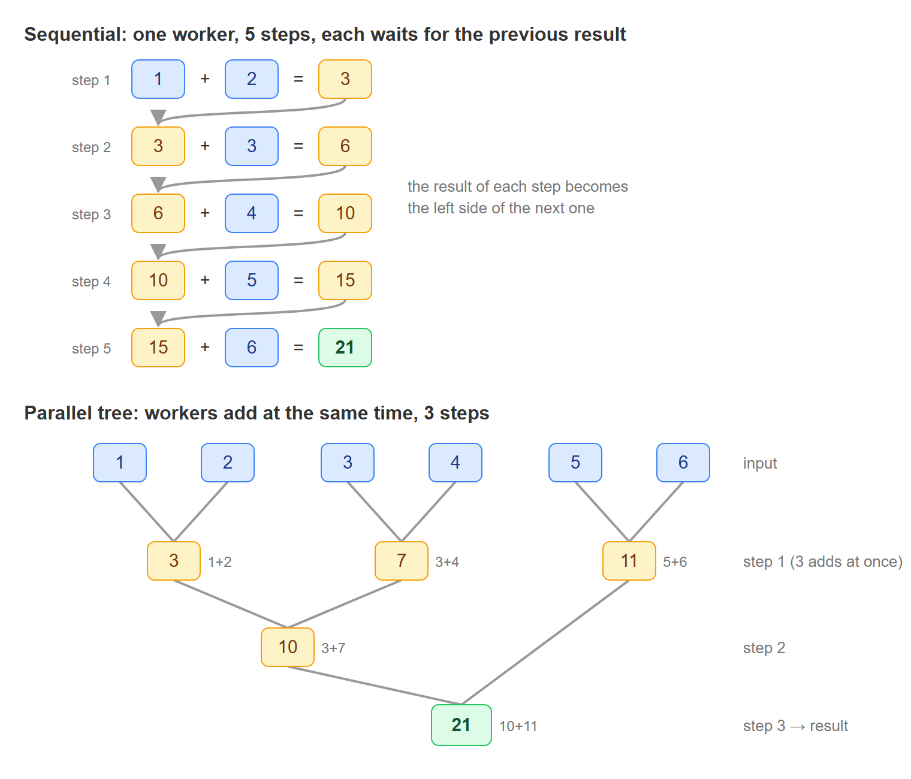
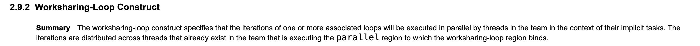
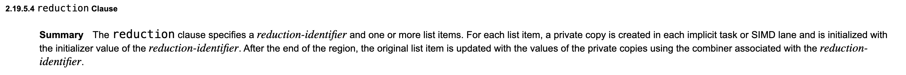
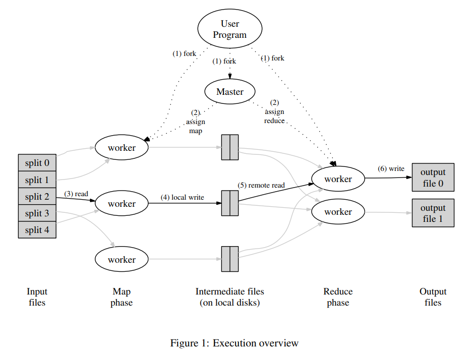
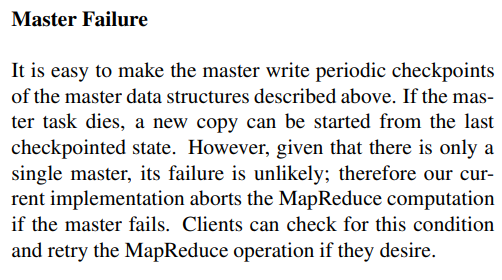
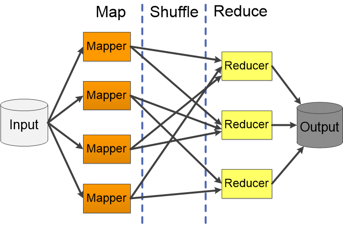

# MapReduce: From Functional Programming to Distributed Systems

## Introduction

- This page covers MapReduce from two angles:
  1. **Programming languages**: where `map` and `reduce` come from, and the math that lets them run in parallel.
  2. **Distributed systems**: how Google used the same idea to process huge datasets across a cluster of machines.
- I also summarize the evolution and the tools used nowadays (Hadoop, Spark, cloud services). The tools changed, but the fundamental theory behind them is still the same.
- The main source (but not the only one) is the original paper: [Dean & Ghemawat (2004). MapReduce: Simplified Data Processing on Large Clusters](https://static.googleusercontent.com/media/research.google.com/en//archive/mapreduce-osdi04.pdf). The paper itself links the two angles: "Our abstraction is inspired by the map and reduce primitives present in Lisp and many other functional languages."

## 1. Perspective of Programming Languages

- `Map` and `Reduce` come from [Lisp](https://pt.wikipedia.org/wiki/Lisp) (1958–60) and the [lambda calculus](https://en.wikipedia.org/wiki/Lambda_calculus) tradition (1930s). They are [higher-order functions](https://en.wikipedia.org/wiki/Higher-order_function): functions that take other functions as arguments.

### Map

- Applies a function to every element of a collection and returns a new collection of the same size.
- It receives a function `a -> b` and a collection of `a`, and returns a collection of `b`.

```haskell
map :: (a -> b) -> [a] -> [b]
```

### Reduce

- Combines all elements of a collection into one value using a binary function.
- Also called `fold`.
- The function receives an accumulator `b` and an item `a`, and returns a new accumulator `b`.

```haskell
foldl :: (b -> a -> b) -> b -> [a] -> b
foldr :: (a -> b -> b) -> b -> [a] -> b
```

- **Left fold** (`foldl`): `((z ⊕ x1) ⊕ x2) ⊕ x3`
- **Right fold** (`foldr`): `x1 ⊕ (x2 ⊕ (x3 ⊕ z))`

### Javascript example

```javascript
const numbers = [1, 2, 3, 4];

const doubled = numbers.map((n) => n * 2);
const sum = numbers.reduce((acc, n) => acc + n, 0);

console.log(doubled); // [2, 4, 6, 8]
console.log(sum); // 10
```

### The math that makes it parallel and useful in distributed systems

A **monoid** is a set with a binary operation `⊕` and an identity element `e` such that:

- **Associativity:** `(a ⊕ b) ⊕ c = a ⊕ (b ⊕ c)`
- **Identity:** `e ⊕ a = a ⊕ e = a`

So with associativity, you can split the data into chunks, reduce each chunk on a
different worker, then reduce the partial results.



_Figure: Sequential vs. parallel tree reduction. Illustration created with Claude._

If the operation is also **commutative** (`a ⊕ b = b ⊕ a`), you don't even need to keep chunks in order, and you can combine partial results in whatever order they arrive.

In distributed systems that's very valuable, because results arrive in unpredictable order over the network.

### OpenMP Example:

```cpp
long sum = 0;
#pragma omp parallel for reduction(+:sum)
for (int i = 0; i < n; i++)
    sum += a[i];
```

### The same steps in OpenMP: parallel for reduction

1. **Split**: The loop iterations are divided among the threads. This is done by the `for`.

- 
  [Figure: 2.9.2 Worksharing-Loop Construct](https://www.openmp.org/spec-html/5.0/openmpsu41.html)

2. **Private copies**: Each thread gets its own private `sum`, initialized to the operator's initializer value, which is the **identity element**.
3. **Local reduce**: Each thread accumulates its chunk into its own copy. Inside the loop, `sum += a[i]` **updates its private copy** instead of the shared `sum`.

- 
  [Figure: 2.19.5.4 reduction Clause](https://www.openmp.org/spec-html/5.0/openmpsu107.html)

4. **Combine.** At the end, the partial results are combined into the original `sum`.

- "At the end of a region that corresponds to a construct for which the reduction clause was specified, the original list item is updated by combining its original value with the final value of each of the private copies, using the combiner of the specified reduction-identifier." - [OMP, Reduction Clauses and Directives](https://www.openmp.org/spec-html/5.0/openmpsu107.html)

## 2. Perspective of Distributed Systems

### Google's MapReduce paper (Dean & Ghemawat, 2004)

- Google describes their internal MapReduce solution to achieve availability and reliability when processing large amounts of data on a cluster with hundreds or thousands of machines connected over the network.

  

**Master**: Assigns tasks, tracks progress and re-runs failed tasks. It is a single point of failure, as the authors write in the paper:



**Map workers**: Read (key, value) pairs from a "split" (file chunk) and apply the `Map function`. The key/value pairs produced are buffered in memory and periodically written to the local disk, partitioned into **R** partitions, **one per reduce task**. The **locations** of these pairs are passed back to the **master**, which forwards these locations to the reduce workers.

**Reduce workers**: Use remote procedure calls (`RPCs`) to read the local disks of map workers. When a reduce worker has read all intermediate data, it sorts it by the intermediate keys to group all occurrences of the same key together. Then, for each unique key encountered, it passes the key and the corresponding set of values to the user's `Reduce function`. The output of this Reduce function is appended to a final output file for this reduce partition.

These files are usually stored in a separate distributed system that can handle data split across multiple files. It is not a machine's local disk but a global file system, so once a reduce task completes, its output is no longer lost if that machine fails.

**When all map tasks and reduce tasks have been completed**, the master wakes up the user program.

### Map Shuffle Reduce



Source: [Imbalanced Big Data Oversampling: Taxonomy, Algorithms, Software, Guidelines and Future Directions](https://www.researchgate.net/publication/353478860_Imbalanced_Big_Data_Oversampling_Taxonomy_Algorithms_Software_Guidelines_and_Future_Directions)

**Shuffle** is the step between map and reduce that **moves the intermediate data across the network** so that all **values with the same key end up on the same reduce worker**. That includes:

1. **Partitioning:** each map worker splits its output into R regions on its local disk, one per reduce task, using the partitioning function (default `hash(key) mod R`).
2. **Transfer:** each reduce worker reads its region from every map worker over the network (RPCs).
3. **Sorting:** each reduce worker sorts the data by key, so all values of the same key are grouped together before `Reduce` is called.

The original paper only mentions the word "shuffling" when it measures the data "sent over the network from the map tasks to the reduce tasks". It does not split the process into **Map -> Shuffle -> Reduce**.

### Fault tolerance

- Since Google's paper mentions running it on commodity machines in large clusters with a huge number of machines, these machines fail.
- And for that there are multiple techniques to ensure the large data processing will continue. I will mention only a couple of them below:
  **Master**: Is the main point to handle fault tolerance. It pings the workers periodically to check if they failed and re-runs failed tasks.
  **Map task fails**: Re-run it on another machine and set all its assigned splits as pending again, since their output was stored on a local disk that is now lost.
  **Reduce task fails**: Re-run its tasks. Map outputs are still on the mappers' local disks, so we can do that.
  **Machine dies**: All its tasks are rescheduled.

## 3. MapReduce in Distributed Systems Evolution

### Timeline

- **2003 – GFS**: Google's distributed file system, where MapReduce reads and writes data.
- **2004 – MapReduce**: Google's paper. Only the paper, no code.
- **2006 – Hadoop**: open-source version. **HDFS** = GFS, **Hadoop MapReduce** = MapReduce.
- **2013 – Hadoop 2 (YARN)**: cluster resources separated from MapReduce, so other engines (like Spark) can run on Hadoop.
- **2014 – Spark**: keeps data **in memory** between steps instead of writing to disk after every job, so it is much faster. Lost data is recomputed from its transformations (lineage).
- **2016+ – Spark 2/3/4**: SQL and DataFrames become the main API, plus streaming and runtime query optimization.

### Nowadays: big tech (on-premise)

- **Google**: replaced GFS with [Colossus](https://cloud.google.com/blog/products/storage-data-transfer/a-peek-behind-colossus-googles-file-system) and MapReduce with [Flume](https://research.google/pubs/flumejava-easy-efficient-data-parallel-pipelines/). Internal only.
- **Microsoft**: uses [Cosmos/SCOPE](https://www.vldb.org/pvldb/vol1/1454166.pdf). Internal only.
- **Meta**: uses **open-source** tools, [Spark](https://engineering.fb.com/2016/08/31/core-infra/apache-spark-scale-a-60-tb-production-use-case/) and [Presto](https://engineering.fb.com/2013/11/06/open-source/presto-interacting-with-petabytes-of-data-at-facebook/) (created by Meta itself), running on its own internal file system [Tectonic](https://www.usenix.org/conference/fast21/presentation/pan).
- Same ideas as 2004: split data, process in parallel, shuffle by key, re-run what fails.

### Nowadays: cloud

- **HDFS** replaced by object storage (S3, GCS, Azure Blob).
- **Managed Spark**: AWS EMR, Google Dataproc, Azure HDInsight, Databricks.
- **Serverless SQL**: BigQuery, Snowflake, Athena. You write SQL, the provider handles the machines.

## References

- [Haskell Tutorials: Lambdas](https://www.haskelltutorials.com/without-theory/lambdas.html)
- [OpenMP](https://openmp.org/)
- [OpenMP 5.0 Spec: 2.9.2 Worksharing-Loop Construct](https://www.openmp.org/spec-html/5.0/openmpsu41.html)
- [OpenMP 5.0 Spec: 2.19.5.4 reduction Clause](https://www.openmp.org/spec-html/5.0/openmpsu107.html)
- [Dean & Ghemawat (2004). MapReduce: Simplified Data Processing on Large Clusters. OSDI '04](https://static.googleusercontent.com/media/research.google.com/en//archive/mapreduce-osdi04.pdf)
- [Apache Hadoop](https://hadoop.apache.org/)
- [Apache Spark](https://spark.apache.org/)
- [Sleeman & Krawczyk (2022). Imbalanced Big Data Oversampling: Taxonomy, Algorithms, Software, Guidelines and Future Directions. ACM Computing Surveys](https://arxiv.org/abs/2107.11508)