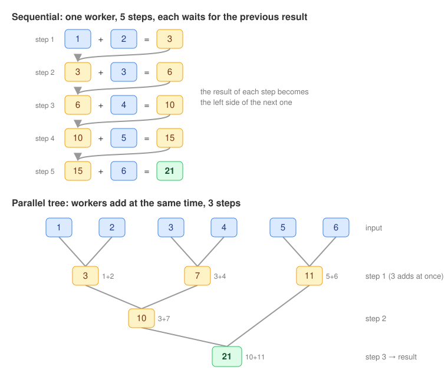

# Map Reduce

## Introduction

- This page covers MapReduce from two angles:
  1. **Programming languages**: where `map` and `reduce` come from, and the math that lets them run in parallel.
  2. **Distributed systems**: how Google used the same idea to process huge datasets across a cluster of machines.
- The main source (but not the only one) is the original paper: [Dean & Ghemawat (2004). MapReduce: Simplified Data Processing on Large Clusters](https://static.googleusercontent.com/media/research.google.com/en//archive/mapreduce-osdi04.pdf). The paper itself links the two angles: "Our abstraction is inspired by the map and reduce primitives present in Lisp and many other functional languages."

## Perspective of Programming Languages

- `Map` and `Reduce` come from [Lisp](https://pt.wikipedia.org/wiki/Lisp) (1958–60) and the [lambda calculus](https://en.wikipedia.org/wiki/Lambda_calculus) tradition (1930s). They are [higher-order functions](https://en.wikipedia.org/wiki/Higher-order_function): functions that take other functions as arguments.

## Map

- Applies a function to every element of a collection and returns a new collection of
  the same size.

```haskell
map :: (a -> b) -> [a] -> [b] -- It receives a collection `a` and returns a collection `b`.
```

## Reduce

- Combines all elements of a collection into one value using a binary function.
- Also called `fold`.

```haskell
foldl :: (b -> a -> b) -> b -> [a] -> b    -- left fold:  ((z ⊕ x1) ⊕ x2) ⊕ x3
foldr :: (a -> b -> b) -> b -> [a] -> b    -- right fold: x1 ⊕ (x2 ⊕ (x3 ⊕ z))

-- It receives an accumulator `b`, and an item `a`. And returns a new accumulator `b`.
```

## Javascript example

```javascript
const numbers = [1, 2, 3, 4];

const doubled = numbers.map((n) => n * 2);
const sum = numbers.reduce((acc, n) => acc + n, 0);

console.log(doubled); // [2, 4, 6, 8]
console.log(sum); // 10
```

## The math that makes it parallel and useful in distributed systems

A **monoid** is a set with a binary operation `⊕` and an identity element `e` such that:

- **Associativity:** `(a ⊕ b) ⊕ c = a ⊕ (b ⊕ c)`
- **Identity:** `e ⊕ a = a ⊕ e = a`

So with associativity, you can split the data into chunks, reduce each chunk on a
different worker, then reduce the partial results.



_Figure: Sequential vs. parallel tree reduction. Illustration created with Claude._

If the operation is also **commutative** (`a ⊕ b = b ⊕ a`), you don't even need to keep chunks in order, and you can combine partial results in whatever order they arrive.

In distributed systems that's very valuable, because results arrive in unpredictable order over the network.

### OpenMP Example:

```cpp
long sum = 0;
#pragma omp parallel for reduction(+:sum)
for (int i = 0; i < n; i++)
    sum += a[i];
```

### The same steps in OpenMP: parallel for reduction

1. **Split**: The loop iterations are divided among the threads. This is done by the `for`.

- 
  [Figure: 2.9.2 Worksharing-Loop Construct](https://www.openmp.org/spec-html/5.0/openmpsu41.html)

2. **Private copies**: Each thread gets its own private `sum`, initialized to the operator's initializer value, which is the **identity element**.
3. **Local reduce**: Each thread accumulates its chunk into its own copy. Inside the loop, `sum += a[i]` **updates its private copy** instead of the shared `sum`.

- 
  [Figure: 2.19.5.4 reduction Clause](https://www.openmp.org/spec-html/5.0/openmpsu107.html)

4. **Combine.** At the end, the partial results are combined into the original `sum`.

- "At the end of a region that corresponds to a construct for which the reduction clause was specified, the original list item is updated by combining its original value with the final value of each of the private copies, using the combiner of the specified reduction-identifier." - [OMP, Reduction Clauses and Directives](https://www.openmp.org/spec-html/5.0/openmpsu107.html)

## Perspective of Distributed Systems
... in progress


## References

- [Haskell Tutorials: Lambdas](https://www.haskelltutorials.com/without-theory/lambdas.html)
- [OpenMP](https://openmp.org/)
- [OpenMP 5.0 Spec: 2.9.2 Worksharing-Loop Construct](https://www.openmp.org/spec-html/5.0/openmpsu41.html)
- [OpenMP 5.0 Spec: 2.19.5.4 reduction Clause](https://www.openmp.org/spec-html/5.0/openmpsu107.html)
- [Dean & Ghemawat (2004). MapReduce: Simplified Data Processing on Large Clusters. OSDI '04](https://static.googleusercontent.com/media/research.google.com/en//archive/mapreduce-osdi04.pdf)