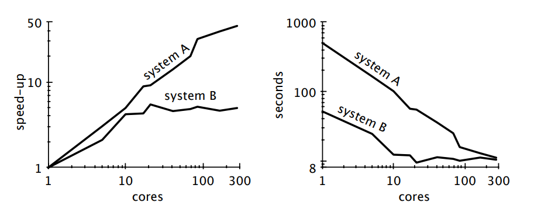
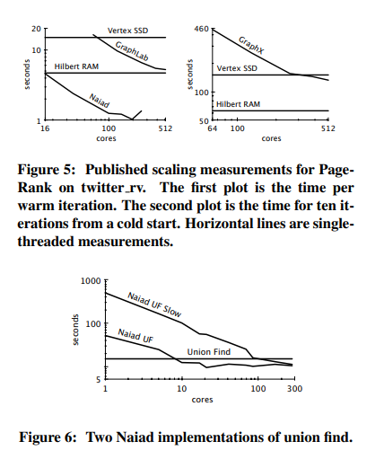

# Scalability! But at what COST? Paying More to Be Slower

## Introduction

[Scalability! But at what COST?](https://files.usenix.org/s3fs-public/cdn/hotos15-paper-mcsherry.pdf) is a paper by Frank McSherry, Michael Isard and Derek G. Murray. It questions how big data systems are evaluated: most papers show how well a system scales, but few compare it against a simple single-threaded solution. Are these systems really faster, or are they just spreading their own overhead across many cores? To answer that, the authors propose a new metric called **COST**.

The paper opens with this quote:

> "You can have a second computer once you've shown you know how to use the first one." - Paul Barham

In other words, adding more machines only makes sense once we already use a single machine well.

## 1. The problem

The authors compare published results of distributed graph processing systems against single-threaded implementations running on a laptop. In several cases, systems running on 128 cores were **slower than one thread**.

According to them, big data research "has fetishized scalability" as the most important feature of a system. In practice, many teams choose a distributed approach from the start, expecting to need it at large scale, and commercial reasons and real needs like fault tolerance also push in that direction. The result is that the option of solving the problem with fewer resources is often not even considered.

## 2. Scaling well is not performing well

**Speed-up** measures how much faster a system gets when more processors are added:

```
S(p) = T(1) / T(p)

p    = number of processors
T(1) = execution time with 1 processor
T(p) = execution time with p processors
```



[Figure 1: Scaling and performance measurements for a data-parallel algorithm, before (system A) and after (system B) a simple performance optimization.](https://files.usenix.org/s3fs-public/cdn/hotos15-paper-mcsherry.pdf)

In the left graph, System A scales much better than System B. But the right graph shows that System B is faster than System A at **every** number of cores. So System A is not the better system, and looking at only the speed-up graph leads to the wrong conclusion.

System B is the same system after an optimization that removed overhead. With less overhead to split across cores, the speed-up curve looks worse, even though the system is faster.

## 3. The COST metric

**COST = Configuration that Outperforms a Single Thread.**

It answers one question: how many cores does a system need before it beats a competent single-threaded implementation?

- **Low COST** (e.g. 16 cores): the overhead is small and parallelism pays off quickly.
- **Unbounded COST**: no configuration ever beats the single thread.

The metric matters because it does not measure parallelism alone. It measures the **real performance gain** of parallelism, after accounting for all the overhead added to make it possible.

## 4. How the comparison was done

The authors used the numbers **published by the authors** of systems such as Spark, GraphLab and GraphX, and compared them with their own single-threaded implementations running on a 2014 laptop with the same datasets. The distributed systems were not re-run. This is a reasonable choice, since the authors of a system usually publish the best results they can get.

### COST of real systems



In both figures, the curves are the distributed systems and the horizontal lines are the single-threaded versions. The COST is the number of cores where a curve crosses the line. If it never crosses, the COST is unbounded.

Figure 6 shows two Naiad implementations of the same algorithm, the System A and System B from Figure 1. The only difference is that the slower one stores its data in hash tables and the faster one in arrays, and that alone made the COST 10x higher.

| System   | Task                                                  | COST              |
| -------- | ----------------------------------------------------- | ----------------- |
| Naiad    | PageRank on the twitter_rv graph                      | 16 cores          |
| GraphLab | PageRank on the twitter_rv graph                      | 512 cores         |
| GraphX   | PageRank on the twitter_rv graph                      | Unbounded         |
| Naiad    | Graph connectivity (union-find), state in arrays      | 10 cores          |
| Naiad    | Graph connectivity (union-find), state in hash tables | roughly 100 cores |

## 5. Where the overhead comes from

**The programming model.** To make parallelism easy, these systems restrict the programs you can write. MapReduce intentionally prevents keeping data in RAM between steps, and the "think like a vertex" model "captures only a limited subset of efficient graph algorithms". This often means you can't use the most efficient algorithm for the problem.

**Communication.** The data is split across machines, so intermediate results have to travel over the network. Some systems, like GraphLab and GraphX, use smarter partitioning just to reduce this cost.

**The hardware.** Clusters favor capacity and throughput, with slower cores, memory and storage than a high-end laptop.

**The implementation.** High-level languages add garbage collection, bounds checks and memory copies, and research prototypes often have basic serialization, memory management and networking.

## 6. Limitations of the paper

**Different environments.** The paper compares optimized single-threaded code against cluster results published in other papers. The hardware and the year of those measurements are different, and the optimized algorithms may favor the single thread. The authors acknowledge this: "The comparisons are neither perfect nor always fair, but the conclusions are sufficiently dramatic that some concern must be raised."

**Data preparation time.** The graph datasets were converted to a binary format, and the paper does not say whether that time was counted. It is also unclear whether data preparation time was included in the published results of the distributed systems.

## 7. Lessons

1. **Report absolute execution time.** Scaling well is not the same as performing well.
2. **Choosing the right algorithm matters more than adding hardware.** Distributed systems often use algorithms that are easy to parallelize but do much more work. A better algorithm and data structure on a single thread can be faster than the same problem running on hundreds of cores.
3. **Compare against a good baseline.** COST is a simple way to do that.
4. **A high COST can be justified** by fault tolerance and the need for availability.

## References

- [McSherry, Isard & Murray (2015). Scalability! But at what COST? HotOS XV](https://files.usenix.org/s3fs-public/cdn/hotos15-paper-mcsherry.pdf)
- [Talk: Scalability! But at what COST?](https://www.youtube.com/watch?v=6bWBEJBMNG0)
